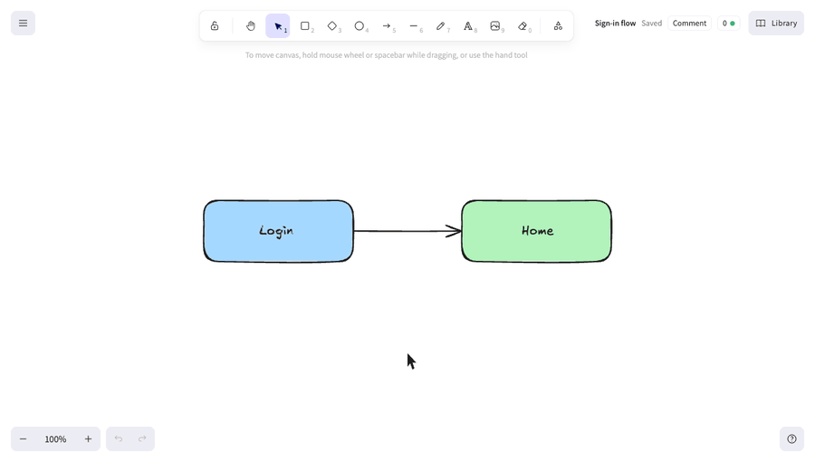
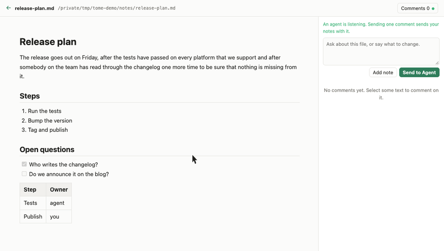

# tome-skill

[English](README.md) · [简体中文](README.zh-CN.md) · 日本語

コーディングエージェント用の skill 集です。Agent Tome のために作りましたが、Agent Tome が無くても使えます。skill は 1 つずつ `skills/<名前>/` のフォルダで、`SKILL.md` がエージェントへの使い方の説明、`scripts/` がエージェントの実行するコマンドです。skill は手元のコンピューターで小さなページを起動します。エージェントがそのアドレスを渡し、人はブラウザーで作業し、エージェントはその内容を読んで応えます。

| skill | できること |
| --- | --- |
| `tome-board` | ボード（Excalidraw）：ブラウザーの同じボードに人とエージェントが描く。ファイルは Obsidian の vault に保存される |
| `tome-md` | Markdown：ブラウザーで表示したファイルの一部を選んでコメントや質問を書くと、エージェントがスレッドで答え、ファイルを直す |

## インストール

skill のフォルダを、エージェントが skill を読む場所にリンクします（Claude Code は `~/.claude/skills/`）。

```sh
ln -s "$PWD/skills/tome-board" ~/.claude/skills/tome-board
ln -s "$PWD/skills/tome-md" ~/.claude/skills/tome-md
```

`tome-md` はビルド不要で、リンクすればそのまま使えます。`tome-board` のページは最初に 1 回ビルドします（Node 20 以上）。

```sh
cd apps/board && npm ci --ignore-scripts && node build.mjs
```

## tome-board：ボード



*範囲を選んでコメントすると、エージェントが図を直し、スレッドで返信します。（デモは英語の画面です。ページはブラウザーの言語に合わせて表示されます。）*

`scripts/board.mjs` がコマンドとローカルサーバーを兼ねます（Node 20 以上、依存パッケージなし）。`scripts/editor/` がページで、`apps/board` からビルドします（git には入れません）。エージェントが `open` を実行し、出てきたアドレスを人に渡します。

```sh
node skills/tome-board/scripts/board.mjs open            # 動いていなければ起動し、{"url": "http://127.0.0.1:4740/", …} を出力：ボードの一覧
node skills/tome-board/scripts/board.mjs open flow       # そのボードのアドレス・ファイル・png。無ければ、作成するかをページで尋ねるアドレス
node skills/tome-board/scripts/board.mjs new flow        # 空のボードを作り、ノートに添付するための 2 行を出力
node skills/tome-board/scripts/board.mjs list
node skills/tome-board/scripts/board.mjs stop
node skills/tome-board/scripts/board.mjs comments --wait         # 人がコメントをエージェントに送るまで待ち、そのコメントを出力して終了
node skills/tome-board/scripts/board.mjs comment-reply <id> "…"  # 返信（--resolve で同時に閉じる）。comment-resolve <id> は閉じるだけ
```

- **vault**：`--vault` で指定します。指定が無ければ `$TOME_BOARD_VAULT`、Agent Tome に設定された vault（その home の `config.json`）、現在のフォルダより上にある最も近い Obsidian の vault の順に探します。
- **ファイル**：vault の `Excalidraw/`（Obsidian の Excalidraw プラグインで別のフォルダを設定していればそのフォルダ）にある `<名前>.excalidraw.md` です。プラグインと同じ形式なので、Obsidian でも同じファイルを開けます。描く手を止めて 0.8 秒で自動保存し、同時にボード全体の画像 `<名前>.png` を隣に書きます（エージェントが見るためのものです）。
- **エージェントが描くとき**は、ファイルの `json` ブロックにある `elements` を直接編集します。開いているページにはすぐ反映され、変わった図形に緑の枠が付きます（右上の「外部で N か所変更」で消せます）。⌘Z で取り消せます。その後ページが自分の形式でファイルを書き直し、画像も更新します。
- **範囲へのコメント**：右上の「コメント」を押します。図形を選んでから押すか、押した後で範囲をドラッグするか図形をクリックし、どう変えるか・何を聞きたいかを書きます。エージェントが `comments --wait` を実行している間はボタンが「Agent に送る」になり、コメント（文章、範囲、その中の図形、その図形の画像）がエージェントに渡ります。待っているエージェントがいなければ保存だけされ、エージェントは `comments` で読みます。エージェントの返信はコメントの下に表示されます。コメントは vault ではなく `~/.tome-board/comments/` に保存します。
- **ボードの一覧**（`/`）：最近変更した順に並び、名前で検索でき、「新しいボード」で作れます。メニュー（☰）には「すべてのボード」「画像のパスをコピー」「ファイルのパスをコピー」があります。
- **vault ごとに 1 プロセス**で、その vault のボードをすべて扱います。127.0.0.1 だけで待ち受け（4740、使用中なら空いている次のポート）、このコンピューター宛て（`127.0.0.1` か `localhost`。コンテナから転送されたポートは番号が変わることがあるためポートは問いません）のリクエストにだけ応えるので、他のサイトのページからは読むことも書くこともできません。触るのはボードのフォルダにある `.excalidraw.md`・`.excalidraw`・`.png` だけで、書き込みはアトミックに行い、リビジョンを確かめます。
- **動いているプロセス**は `~/.tome-board/servers/<id>.json` に記録します（`$TOME_BOARD_HOME` で場所を変えられます）：`pid`・`url`・`port`・`root`・`kind: "board"`・`startedAt`。Agent Tome はこのファイルを見て、ローカルページの一覧にボードを出します。スクリプトやページを更新すると、次の `open` で古いプロセスが入れ替わります。
- **テスト**：`cd apps/board && npm test`（ファイル形式、ページの訳、サーバーのルール）。
- **サードパーティのライセンス**（Excalidraw、フォント、依存パッケージ）は `scripts/editor/THIRD_PARTY_LICENSES.txt` にあり、ボードの一覧の一番下からリンクしています。Mermaid の取り込みと共同編集は入れていません。

## tome-md：Markdown



*文章を選んでコメントすると、エージェントがファイルを直して返信します。続けてファイル全体について質問しています。（デモは英語の画面です。ページはブラウザーの言語に合わせて表示されます。）*

`scripts/md.mjs` がコマンドとローカルサーバーを兼ねます（Node 20 以上、依存パッケージなし）。`scripts/page/` がページで、素の JavaScript なのでビルドは不要です。Markdown の解析には同梱の marked を使います（ライセンスは `scripts/page/vendor/marked.LICENSE.md`）。

```sh
node skills/tome-md/scripts/md.mjs open notes.md       # 動いていなければ起動し、{"url": "http://127.0.0.1:4750/d/<id>", …} を出力
node skills/tome-md/scripts/md.mjs open                # 開いたファイルの一覧ページ
node skills/tome-md/scripts/md.mjs list
node skills/tome-md/scripts/md.mjs close notes.md      # 一覧から外す（ファイルはそのまま）
node skills/tome-md/scripts/md.mjs stop
node skills/tome-md/scripts/md.mjs comments --wait         # 人がコメントをエージェントに送るまで待ち、そのコメントを出力して終了
node skills/tome-md/scripts/md.mjs comment-reply <id> "…"  # 返信（--resolve で同時に閉じる）。comment-resolve <id> は閉じるだけ
```

- **ページはファイルを読むだけで、書き換えません。** 人は自分のエディターで、エージェントはファイルを直接編集します。ファイルが変わるとページにすぐ反映され、新しいブロックと書き換えられたブロックの左に緑の線が付きます（右上の「N か所変更」で消せます）。
- **コメント**：文章を選んで「コメント」を押すか、パネルの一番上の欄にファイル全体について書きます。「メモを追加」は保存するだけで送りません。エージェントが `comments --wait` を実行している間は隣に「Agent に送る」が出て、そのコメントと、同じファイルにそれまで追加したメモをまとめて渡します（文章、選んだ原文、その行、属している見出し）。待っているエージェントがいなければメモは保存だけされ、エージェントは `comments` で読みます。エージェントの返信はコメントの下に表示されます。
- **表示するのは `open` で開いたファイルだけ**です（`.md`・`.markdown`）。ページから別のファイルを開く手段はありません。画像は Markdown ファイルの近くにあるファイル（同じ vault かリポジトリの中で、隠しフォルダの外）だけを表示し、ウェブ上の画像は読み込みません。ファイルに書かれた HTML は文字として表示し、実行しません。
- **コンピューターごとに 1 プロセス**です。127.0.0.1 だけで待ち受け（4750、使用中なら空いている次のポート）、ボードと同じく、このコンピューター宛てのリクエストにだけ応えます。
- **自分の記録**はすべて `~/.tome-md/` にあります（`$TOME_MD_HOME` で場所を変えられます）：開いたファイル、動いているプロセス（`servers/main.json`、`kind: "md"`）、コメント。
- **テスト**：`cd apps/md && npm test`。

## ライセンス

MIT。[LICENSE](LICENSE) を参照してください。
