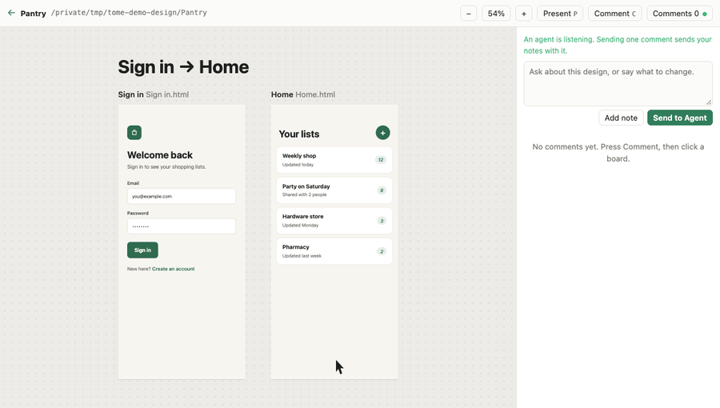
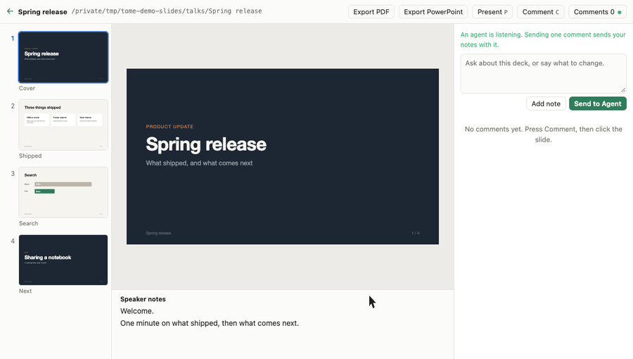
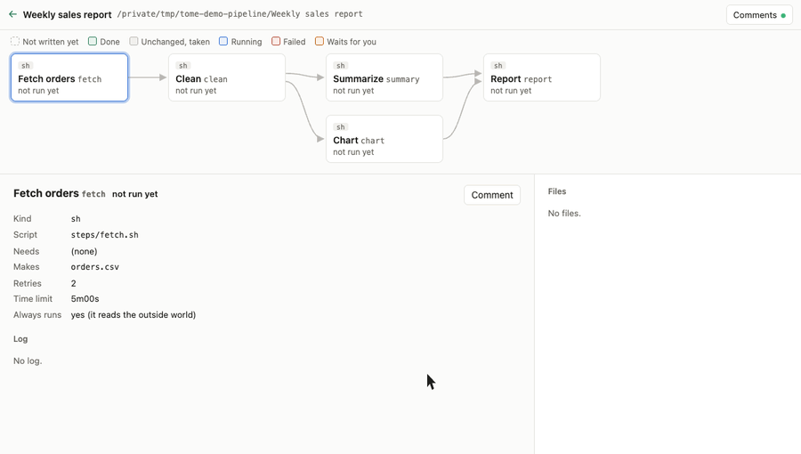
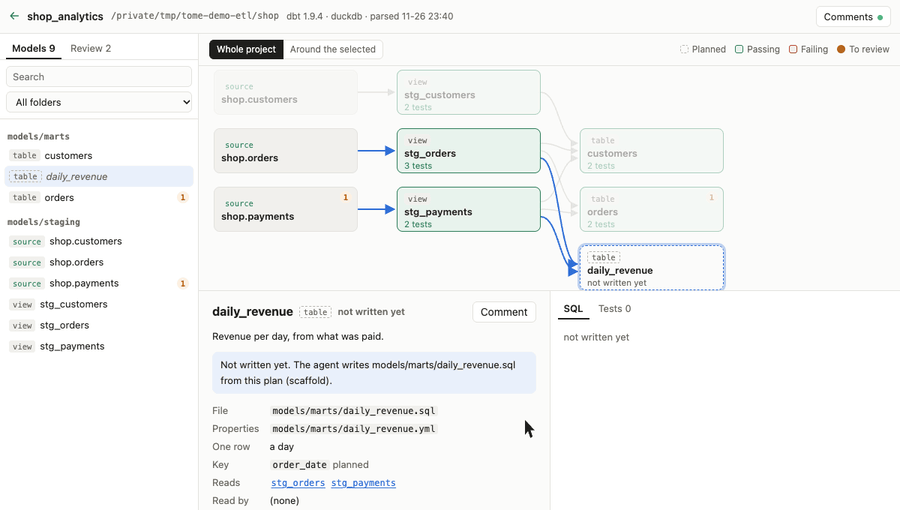

# tome-skill

[English](README.md) · [简体中文](README.zh-CN.md) · 日本語

コーディングエージェント用の skill 集です。Agent Tome のために作りましたが、Agent Tome が無くても使えます。skill は 1 つずつ `skills/<名前>/` のフォルダで、`SKILL.md` がエージェントへの使い方の説明、`scripts/` がエージェントの実行するコマンドです。skill は手元のコンピューターで小さなページを起動します。エージェントがそのアドレスを渡し、人はブラウザーで作業し、エージェントはその内容を読んで応えます。

| skill | できること |
| --- | --- |
| `tome-board` | ボード（Excalidraw）：ブラウザーの同じボードに人とエージェントが描く。ファイルは Obsidian の vault に保存される |
| `tome-md` | Markdown：ブラウザーで表示したファイルの一部を選んでコメントや質問を書くと、エージェントがスレッドで答え、ファイルを直す |
| `tome-design` | デザイン：普通の HTML で書いたボードを、ブラウザーのキャンバスに並べて見る。要素をクリックするか範囲を囲んでコメントすると、エージェントがファイルを直してスレッドで答える |
| `tome-slides` | スライド：1 枚 1 つの普通の HTML ファイル。ブラウザーでスライドとスピーカーノートを見て、全画面でプレゼン、発表者ビュー、PDF・PowerPoint 保存。要素をクリックするか範囲を囲んでコメントすると、エージェントがファイルを直してスレッドで答える |
| `tome-pipeline` | パイプライン：ステップ（スクリプト、エージェントへのプロンプト、人への質問）を並べたフォルダー。各ステップが何を必要とし何を出すかを書く。定期実行でも手動でも動き、入力が変わらないステップは前回の結果を使い、失敗や回答待ちの実行は続きから再開できる。ページでは状態ごとに色分けしたステップと、それぞれのログ・出力を見られる。ステップにコメントすると、エージェントが直して再実行し、返信する |
| `tome-etl` | dbt プロジェクトをグラフで見る：モデル・ソース・seed・snapshot を「どれがどれを読むか」で並べ、モデルを選ぶと SQL・列・テスト・直近の結果が見られる。まだ書いていないモデルは計画として破線で描き、エージェントがファイルを作る。レビューはテスト・キーのテスト・説明が足りないモデルを挙げる。モデルや列にコメントすると、エージェントが SQL と YAML を直して返信する |

## インストール

skill のフォルダを、エージェントが skill を読む場所にリンクします（Claude Code は `~/.claude/skills/`）。

```sh
ln -s "$PWD/skills/tome-board" ~/.claude/skills/tome-board
ln -s "$PWD/skills/tome-md" ~/.claude/skills/tome-md
ln -s "$PWD/skills/tome-design" ~/.claude/skills/tome-design
ln -s "$PWD/skills/tome-slides" ~/.claude/skills/tome-slides
ln -s "$PWD/skills/tome-pipeline" ~/.claude/skills/tome-pipeline
ln -s "$PWD/skills/tome-etl" ~/.claude/skills/tome-etl
```

`tome-md`・`tome-design`・`tome-slides`・`tome-pipeline`・`tome-etl` はビルド不要で、リンクすればそのまま使えます。`tome-board` のページは最初に 1 回ビルドします（Node 20 以上）。

```sh
cd apps/board && npm ci --ignore-scripts && node build.mjs
```

## tome-board：ボード


*範囲を選んでコメントすると、エージェントが図を直し、スレッドで返信します。（デモは英語の画面です。ページはブラウザーの言語に合わせて表示されます。）*

`scripts/board.mjs` がコマンドとローカルサーバーを兼ねます（Node 20 以上、依存パッケージなし）。`scripts/editor/` がページで、`apps/board` からビルドします（git には入れません）。エージェントが `open` を実行し、出てきたアドレスを人に渡します。

```sh
node skills/tome-board/scripts/board.mjs open            # 動いていなければ起動し、{"url": "http://127.0.0.1:4740/", …} を出力：ボードの一覧
node skills/tome-board/scripts/board.mjs open flow       # そのボードのアドレス・ファイル・png。無ければ、作成するかをページで尋ねるアドレス
node skills/tome-board/scripts/board.mjs new flow        # 空のボードを作り、ノートに添付するための 2 行を出力
node skills/tome-board/scripts/board.mjs list
node skills/tome-board/scripts/board.mjs stop
node skills/tome-board/scripts/board.mjs comments --wait         # 人がコメントをエージェントに送るまで待ち、そのコメントを出力して終了
node skills/tome-board/scripts/board.mjs comment-reply <id> "…"  # 返信（--resolve で同時に閉じる）。comment-resolve <id> は閉じるだけ
```

- **vault**：`--vault` で指定します。指定が無ければ `$TOME_BOARD_VAULT`、Agent Tome に設定された vault（その home の `config.json`）、現在のフォルダより上にある最も近い Obsidian の vault の順に探します。
- **ファイル**：vault の `Excalidraw/`（Obsidian の Excalidraw プラグインで別のフォルダを設定していればそのフォルダ）にある `<名前>.excalidraw.md` です。プラグインと同じ形式なので、Obsidian でも同じファイルを開けます。描く手を止めて 0.8 秒で自動保存し、同時にボード全体の画像 `<名前>.png` を隣に書きます（エージェントが見るためのものです）。
- **エージェントが描くとき**は、ファイルの `json` ブロックにある `elements` を直接編集します。開いているページにはすぐ反映され、変わった図形に緑の枠が付きます（右上の「外部で N か所変更」で消せます）。⌘Z で取り消せます。その後ページが自分の形式でファイルを書き直し、画像も更新します。
- **範囲へのコメント**：右上の「コメント」を押します。図形を選んでから押すか、押した後で範囲をドラッグするか図形をクリックし、どう変えるか・何を聞きたいかを書きます。エージェントが `comments --wait` を実行している間はボタンが「Agent に送る」になり、コメント（文章、範囲、その中の図形、その図形の画像）がエージェントに渡ります。待っているエージェントがいなければ保存だけされ、エージェントは `comments` で読みます。エージェントの返信はコメントの下に表示されます。コメントは vault ではなく `~/.tome-board/comments/` に保存します。
- **ボードの一覧**（`/`）：最近変更した順に並び、名前で検索でき、「新しいボード」で作れます。メニュー（☰）には「すべてのボード」「画像のパスをコピー」「ファイルのパスをコピー」があります。
- **vault ごとに 1 プロセス**で、その vault のボードをすべて扱います。127.0.0.1 だけで待ち受け（4740、使用中なら空いている次のポート）、このコンピューター宛て（`127.0.0.1` か `localhost`。コンテナから転送されたポートは番号が変わることがあるためポートは問いません）のリクエストにだけ応えるので、他のサイトのページからは読むことも書くこともできません。触るのはボードのフォルダにある `.excalidraw.md`・`.excalidraw`・`.png` だけで、書き込みはアトミックに行い、リビジョンを確かめます。
- **動いているプロセス**は `~/.tome-board/servers/<id>.json` に記録します（`$TOME_BOARD_HOME` で場所を変えられます）：`pid`・`url`・`port`・`root`・`kind: "board"`・`startedAt`。Agent Tome はこのファイルを見て、ローカルページの一覧にボードを出します。スクリプトやページを更新すると、次の `open` で古いプロセスが入れ替わります。
- **テスト**：`cd apps/board && npm test`（ファイル形式、ページの訳、サーバーのルール）。
- **サードパーティのライセンス**（Excalidraw、フォント、依存パッケージ）は `scripts/editor/THIRD_PARTY_LICENSES.txt` にあり、ボードの一覧の一番下からリンクしています。Mermaid の取り込みと共同編集は入れていません。

## tome-md：Markdown


*文章を選んでコメントすると、エージェントがファイルを直して返信します。続けてファイル全体について質問しています。（デモは英語の画面です。ページはブラウザーの言語に合わせて表示されます。）*

`scripts/md.mjs` がコマンドとローカルサーバーを兼ねます（Node 20 以上、依存パッケージなし）。`scripts/page/` がページで、素の JavaScript なのでビルドは不要です。Markdown の解析には同梱の marked を使います（ライセンスは `scripts/page/vendor/marked.LICENSE.md`）。

```sh
node skills/tome-md/scripts/md.mjs open notes.md       # 動いていなければ起動し、{"url": "http://127.0.0.1:4750/d/<id>", …} を出力
node skills/tome-md/scripts/md.mjs open                # 開いたファイルの一覧ページ
node skills/tome-md/scripts/md.mjs list
node skills/tome-md/scripts/md.mjs close notes.md      # 一覧から外す（ファイルはそのまま）
node skills/tome-md/scripts/md.mjs stop
node skills/tome-md/scripts/md.mjs comments --wait         # 人がコメントをエージェントに送るまで待ち、そのコメントを出力して終了
node skills/tome-md/scripts/md.mjs comment-reply <id> "…"  # 返信（--resolve で同時に閉じる）。comment-resolve <id> は閉じるだけ
```

- **ページはファイルを読むだけで、書き換えません。** 人は自分のエディターで、エージェントはファイルを直接編集します。ファイルが変わるとページにすぐ反映され、新しいブロックと書き換えられたブロックの左に緑の線が付きます（右上の「N か所変更」で消せます）。
- **コメント**：文章を選んで「コメント」を押すか、パネルの一番上の欄にファイル全体について書きます。「メモを追加」は保存するだけで送りません。エージェントが `comments --wait` を実行している間は隣に「Agent に送る」が出て、そのコメントと、同じファイルにそれまで追加したメモをまとめて渡します（文章、選んだ原文、その行、属している見出し）。待っているエージェントがいなければメモは保存だけされ、エージェントは `comments` で読みます。エージェントの返信はコメントの下に表示されます。
- **表示するのは `open` で開いたファイルだけ**です（`.md`・`.markdown`）。ページから別のファイルを開く手段はありません。画像は Markdown ファイルの近くにあるファイル（同じ vault かリポジトリの中で、隠しフォルダの外）だけを表示し、ウェブ上の画像は読み込みません。ファイルに書かれた HTML は文字として表示し、実行しません。
- **コンピューターごとに 1 プロセス**です。127.0.0.1 だけで待ち受け（4750、使用中なら空いている次のポート）、ボードと同じく、このコンピューター宛てのリクエストにだけ応えます。
- **自分の記録**はすべて `~/.tome-md/` にあります（`$TOME_MD_HOME` で場所を変えられます）：開いたファイル、動いているプロセス（`servers/main.json`、`kind: "md"`）、コメント。
- **テスト**：`cd apps/md && npm test`。

## tome-design：キャンバスのデザイン



*ボードの要素をクリックしてコメントすると、エージェントが HTML ファイルを直して返信します。キャンバスでは変わったボードが囲まれ、続けてプレゼンでクリックしながら進めています。（デモは英語の画面です。ページはブラウザーの言語に合わせて表示されます。）*

`scripts/design.mjs` がコマンドとローカルサーバーを兼ねます（Node 20 以上、依存なし）。`scripts/page/` がページで、普通の JavaScript、ビルド不要です。デザインは 1 つのフォルダーで、`design.json` にボードのキャンバス上の位置を書き、ボードはそれぞれフォルダー内の普通の HTML ファイルです。

```sh
node skills/tome-design/scripts/design.mjs new "ログインの流れ"       # designs/ログインの流れ/ と空の design.json を作って開く。{"url": "http://127.0.0.1:4760/d/<id>", …} を出力
node skills/tome-design/scripts/design.mjs open designs/ログインの流れ   # --board Home.html：そのボードだけ表示
node skills/tome-design/scripts/design.mjs open                       # 開いたデザインの一覧
node skills/tome-design/scripts/design.mjs check designs/ログインの流れ  # design.json とボードの HTML の問題。問題があるうちは終了コード 1
node skills/tome-design/scripts/design.mjs list
node skills/tome-design/scripts/design.mjs close designs/ログインの流れ
node skills/tome-design/scripts/design.mjs stop
node skills/tome-design/scripts/design.mjs comments --wait         # コメントがエージェントに送られるまで待ち、そのコメントを出力して終わる
node skills/tome-design/scripts/design.mjs comment-reply <id> "…"  # 返信（--resolve で解決も）。comment-resolve <id> は解決だけ
```

- **キャンバス**：各ボードがそれぞれの大きさで並び、上に名前が付きます。ドラッグかスクロールで移動、ピンチか ⌘＋スクロールで拡大縮小、F で全体、0 で 100%。ボードをダブルクリックすると単独で表示し、全長が見え、リンクとスクリプトも動きます（‹ › か ← → で前後、Esc で戻る）。
- **プレゼン**（「プレゼン」か P）：ウィンドウ全体に 1 枚ずつ、クリックできるプロトタイプのように表示します。別のボードへのリンク（`<a href="Home.html">`）を押すと次のボードが横から滑り込み（リンクに `data-transition="up"`・`"fade"`・`"none"` で別の動き）、それ以外を押すとリンクの場所が光ります。C でコメントもでき、パネルはボードの横に出ます。← → で順番に、Backspace で戻る、R で最初から、Esc で終了。`open <フォルダー> --present <ファイル>` はそのボードから始まるプレゼンのアドレスを出します。
- **ファイルはエージェントが書き**、開いているページが追従します。変わったボードはすぐ読み直され、緑の枠が付きます（右上の「N 枚変更」で消す）。ページ自体は何も書き換えません。
- **コメント**：「コメント」（か C）を押し、ボードの要素をクリックするか範囲をドラッグして書きます。「メモを追加」は保存だけ。エージェントが `comments --wait` を実行している間の「Agent に送る」は、それまでのメモと一緒に渡します。エージェントには、ボード、ボード内の位置（px）、クリックした要素（CSS パス、テキスト、マークアップの冒頭）か範囲内の要素が届きます。パネル上部の欄はデザイン全体へのコメントです。
- **ボードはサンドボックスで動きます**：それぞれ別のオリジンで、ページにもサーバーの呼び出しにもネットワークにも届きません。読み込めるのは自分のフォルダーのファイルと Google Fonts だけです。
- **コンピューター 1 台に 1 プロセス。** 127.0.0.1 だけで待ち受け（4760、使用中なら上の空きポート）、このコンピューター宛てのリクエストにだけ応えます。自分の記録は `~/.tome-design/`（`$TOME_DESIGN_HOME` で変更）：開いたデザイン、動いているプロセス（`servers/main.json`、`kind: "design"`）、コメント。
- **claude-design の形式ではありません**：その `.dc.html` はその skill のランタイムが必要です。tome-design のボードは普通の HTML で、単独でも開けます。
- **テスト**：`cd apps/design && npm test`。

## tome-slides：スライド



*スライドの要素をクリックしてコメントすると、エージェントがそのスライドのファイルを直して返信します。続けて発表モードで 1 枚ずつ進めています。（デモは英語の画面です。ページはブラウザーの言語に合わせて表示されます。）*

`scripts/slides.mjs` がコマンドとローカルサーバーを兼ねます（Node 20 以上、依存なし。`export` だけ Chrome を使います）。`scripts/page/` がページで、普通の JavaScript、ビルド不要です。スライドは 1 つのフォルダーで、`deck.json` にスライドの順番とスピーカーノートを書き、スライドはそれぞれフォルダー内の普通の HTML ファイルです。

```sh
node skills/tome-slides/scripts/slides.mjs new "四半期の振り返り"        # decks/四半期の振り返り/ と空の deck.json を作って開く。{"url": "http://127.0.0.1:4770/d/<id>", …} を出力
node skills/tome-slides/scripts/slides.mjs open decks/四半期の振り返り   # --slide 3：3 枚目。--present 1：そこから始まるプレゼン
node skills/tome-slides/scripts/slides.mjs open                         # 開いたスライドの一覧
node skills/tome-slides/scripts/slides.mjs check decks/四半期の振り返り  # deck.json と各スライドの HTML の問題。問題があるうちは終了コード 1
node skills/tome-slides/scripts/slides.mjs export decks/四半期の振り返り --pdf   # フォルダーの exports/ に PDF を 1 つ。--pptx：PowerPoint。--png：1 枚ずつ画像
node skills/tome-slides/scripts/slides.mjs list
node skills/tome-slides/scripts/slides.mjs close decks/四半期の振り返り
node skills/tome-slides/scripts/slides.mjs stop
node skills/tome-slides/scripts/slides.mjs comments --wait         # コメントがエージェントに送られるまで待ち、そのコメントを出力して終わる
node skills/tome-slides/scripts/slides.mjs comment-reply <id> "…"  # 返信（--resolve で解決も）。comment-resolve <id> は解決だけ
```

- **スライドを見る**：左に全スライドの列、中央に選んだ 1 枚を大きく、その下にスピーカーノート。← →（か ↑ ↓）で送ります。
- **プレゼン**（「プレゼン」か P。Shift+P で 1 枚目から）：全画面で 1 枚ずつ。→・スペース・クリックで進み、← で戻る、Home・End で最初と最後、B で黒画面、Esc で終了。`data-step="1"`・`"2"`… を付けた要素は 1 回押すごとに 1 つずつ出ます。切り替えはフェード・横からスライド・なしの 3 種（`deck.json` の `transition`、全体か 1 枚ごと）。S で別ウィンドウに発表者ビュー：今のスライド、次、大きな文字のノート、タイマーと時計。そちらのキーでも進められます。プレゼン中も C でコメントでき、パネルはスライドの横に出ます。
- **PDF**：ページの「PDF に書き出す」（または `export --pdf`）でヘッドレスの Chrome が `exports/<タイトル>.pdf` を作り、ページがそれをダウンロードします。各ページはスライドと同じ大きさです。Chrome が無いときはボタンが印刷ダイアログを開きます（「PDF として保存」）。
- **PowerPoint**：ページの「PPTX に書き出す」（または `export --pptx`）で `exports/<タイトル>.pptx` を作ります。各スライドは 1 枚の画像で、スピーカーノートと切り替え効果付き。PowerPoint や Keynote でもブラウザーと同じ見た目で再生できますが、文字はそこでは編集できません。
- **ファイルはエージェントが書き**、開いているページが追従します。変わったスライドはすぐ読み直され、緑の枠が付きます。ページ自体は何も書き換えません。
- **コメント**：「コメント」（か C）を押し、スライドの要素をクリックするか範囲をドラッグして書きます。「メモを追加」は保存だけ。エージェントが `comments --wait` を実行している間の「Agent に送る」は、それまでのメモと一緒に渡します。エージェントには、スライド（何枚目か）、スライド内の位置（px）、クリックした要素か範囲内の要素が届きます。パネル上部の欄はスライド全体へのコメントです。
- **スライドはサンドボックスで動きます**。tome-design のボードと同じく、読み込めるのは自分のフォルダーのファイルと Google Fonts だけです。
- **コンピューター 1 台に 1 プロセス。** 127.0.0.1 だけで待ち受け（4770、使用中なら上の空きポート）。自分の記録は `~/.tome-slides/`（`$TOME_SLIDES_HOME` で変更）：開いたスライド、動いているプロセス（`servers/main.json`、`kind: "slides"`）、コメント。
- **claude-slides の形式ではありません**（`project/deck.json`、使えるインラインスタイルが限られる）：tome-slides のスライドは普通の HTML で CSS も自由、単独でも開けます。書き出す PowerPoint は画像で、文字は編集できません。
- **テスト**：`cd apps/slides && npm test`。

## tome-pipeline：パイプライン



*ステップが失敗し、ログに理由が出ています。そのステップにコメントすると、エージェントがスクリプトを直して返信し、そこから再実行します。（デモは英語の画面です。ページはブラウザーの言語に合わせて表示されます。）*

`scripts/pipeline.mjs` はコマンドであり、実行役であり、ローカルのサーバーでもあります（Node 20 以上、依存なし）。`scripts/page/` はページで、普通の JavaScript なのでビルド不要です。パイプラインは 1 つのフォルダーです。`pipeline.json` に各ステップと、その前提・出力を書き、各ステップは `steps/` のスクリプトかプロンプトです。実行ごとに `runs/<時刻>/` ができ、各ステップのログと出力が入ります。

```sh
node skills/tome-pipeline/scripts/pipeline.mjs new "毎日のニュース"          # pipelines/毎日のニュース/（pipeline.json・steps/・runs/ を外す .gitignore）を作って開く。{"url": "http://127.0.0.1:4780/p/<id>", …} を出力
node skills/tome-pipeline/scripts/pipeline.mjs check pipelines/毎日のニュース   # pipeline.json の問題と、まだ書いていないステップ
node skills/tome-pipeline/scripts/pipeline.mjs run pipelines/毎日のニュース     # 1 回実行。--only <ステップ>：そのステップだけ。--all：前回の結果を使わない
node skills/tome-pipeline/scripts/pipeline.mjs resume pipelines/毎日のニュース  # 最新の実行を続きから。--from <ステップ>：そこから後をやり直す
node skills/tome-pipeline/scripts/pipeline.mjs answer pipelines/毎日のニュース pick "…" --resume   # 待っている質問に答えて続きを実行
node skills/tome-pipeline/scripts/pipeline.mjs status pipelines/毎日のニュース
node skills/tome-pipeline/scripts/pipeline.mjs schedule pipelines/毎日のニュース --cron "0 6 * * *"   # 定期実行に渡すコマンドを出力
node skills/tome-pipeline/scripts/pipeline.mjs open | list | close <フォルダー> | stop
node skills/tome-pipeline/scripts/pipeline.mjs comments --wait         # 人がコメントをエージェントに送るまで待ち、そのコメントを出力して終了
node skills/tome-pipeline/scripts/pipeline.mjs comment-reply <id> "…"  # 返信（--resolve で解決も）。comments：未解決のコメント
```

- **ステップは 3 種類**：`sh` はフォルダー内のスクリプト（またはシェルコマンド）を、この実行のそのステップ用フォルダーで動かします。前提のステップのフォルダーは `$IN_<ID>` にあります。`agent` は Markdown のプロンプトを `claude -p`（または `codex exec` など別のコマンド）に渡し、入力の場所と書くファイルを伝えます。`human` は人に質問し、選択肢は前のステップが出したファイルの各行です。
- **1 回の実行**は前提の順に進み、並べられるものは並行して動きます（`parallel`、既定 4）。ステップごとに `retry` と `timeout` を設定できます。定義・スクリプトかプロンプト・入力がどれも変わらないステップは、以前の実行の結果を使い（ファイルをリンク）、動かしません。外部を読むステップには `fresh: true` を付けます。
- **終わり方**：最後の 1 行が `DONE …`、`FAIL … · <ステップ> · <理由> · log <パス>`、`WAIT … · <ステップ> waits for a person` のどれかで、終了コードは 0・1・3（4：すでに実行中）。`resume` は失敗・回答待ち・中断した実行を同じフォルダーで続けます。
- **常駐もスケジューラーもしない**：1 回の実行が終われば終了します。起動は Bot Tome・launchd・cron・CI などに任せ、起動した側が終了コードと最後の 1 行を読みます。
- **ページ**：ステップを前提の順にグラフで描き、ある実行での状態で色分けします（破線：未実装）。上で実行を切り替えられます。ステップをクリックすると定義・ログ・出力が見られ、画像・音声・動画はその場で再生、テキストは表示、CSV・TSV は表になります。待っている質問にはページで答えられ、答えると続きを実行します。
- **コメント**：ステップを選んで「コメント」を押すか、右のパネル上部の欄にパイプライン全体について書きます。「メモを追加」は送らずに保存します。エージェントが `comments --wait` を実行している間は「Agent に送る」も出て、このコメントとそれまでのメモをまとめて渡します（文章、どのステップか、そのスクリプトかプロンプト、見ていた実行とそのステップのログ）。エージェントはステップを直してそこから再実行し、返信がコメントの下に表示されます。
- **ページはコンピューター 1 台に 1 プロセス。** 127.0.0.1 だけで待ち受けます（4780、使用中なら上の空きポート）。自分の記録は `~/.tome-pipeline/`（`$TOME_PIPELINE_HOME` で変更可）：開いたパイプライン、動いているプロセス（`servers/main.json`、`kind: "pipeline"`）、コメント。
- **テスト**：`cd apps/pipeline && npm test`。

## tome-etl：dbt プロジェクトをグラフで見る



*グラフでモデルを開き、キーのテストを頼むと、エージェントが YAML を直して parse し、返信します。最後に Review タブで残りの指摘を見ています。（デモは英語の画面です。ページはブラウザーの言語に合わせて表示されます。）*

`scripts/etl.mjs` はコマンドであり、ローカルのサーバーでもあります（Node 20 以上、依存なし）。`scripts/page/` はページで、普通の JavaScript なのでビルド不要です。読むのは dbt がプロジェクトの `target/` に書いたファイルだけで、データベースには接続しません。

```sh
node skills/tome-etl/scripts/etl.mjs open path/to/project          # 必要なら起動。{"url": "http://127.0.0.1:4790/p/<id>", …} を出力。--select orders：そのモデルと周り
node skills/tome-etl/scripts/etl.mjs parse path/to/project         # そこで `dbt parse` を実行（どこにも接続しない）し、target/manifest.json を新しくする
node skills/tome-etl/scripts/etl.mjs status path/to/project        # dbt のバージョン、parse した時刻、その後ファイルが変わったか、件数
node skills/tome-etl/scripts/etl.mjs models path/to/project --select "+orders+1"   # モデルごとに 1 行。前後の + は dbt と同じ
node skills/tome-etl/scripts/etl.mjs show path/to/project orders   # モデル 1 つ：ファイル、列、テストと直近の結果、上流、下流
node skills/tome-etl/scripts/etl.mjs review path/to/project        # モデルに足りないもの
node skills/tome-etl/scripts/etl.mjs check path/to/project         # tome-etl.json：問題、計画でまだ決まっていない点、作成済みの計画
node skills/tome-etl/scripts/etl.mjs scaffold path/to/project      # まだ書いていない計画の .sql と .yml を作る。既存のファイルは上書きしない
node skills/tome-etl/scripts/etl.mjs open | list | close <プロジェクト> | stop
node skills/tome-etl/scripts/etl.mjs comments --wait         # コメントがエージェントに送られるまで待ち、そのコメントを出力して終了
node skills/tome-etl/scripts/etl.mjs comment-reply <id> "…"  # 返信（--resolve で同時に解決）。comment-resolve <id> は解決だけ
```

- **読むもの**：`target/manifest.json`（`dbt parse` が作る：モデル、それぞれが読むもの、列、テスト、SQL）。あれば `run_results.json`（モデルとテストの直近の結果）、`catalog.json`（列の型と行数、`dbt docs generate` が作る）、`sources.json`（鮮度）も読みます。テストには dbt 1.4・1.7・1.12 の manifest が入っています。Jinja と SQL を自分では解析しません。
- **実行する dbt コマンドは `dbt parse` だけです。** 実行・テスト・ビルドは、あなたかエージェントが開発用の target に対して行います。dbt の起動方法は `tome-etl.json` の `"dbt"`、なければ `$TOME_ETL_DBT`、なければプロジェクトの `.venv/bin/dbt`、最後に `dbt` です。
- **ページ**：左にモデルの一覧（検索・フォルダー・タグ、「レビュー」タブ）、中央にグラフ、その下に選んだモデル（ファイル、キー、列とそのテスト、直近の実行、書いたままの SQL とコンパイル後の SQL、テスト）、右にコメント。小さいプロジェクトは全体を描き、選んだモデルの上流と下流を強調します。大きいプロジェクトは選んだモデルと前後 1・2・3 段または全部だけを描くので、モデルが数千あっても使えます。
- **計画**：まだ書いていないモデルやソースは、プロジェクトの `tome-etl.json` の 1 項目です（1 行が何か、キー、読むもの、マテリアライズの方法、列とテスト）。実在のモデルの間に破線で描かれます。`scaffold` がその `.sql`（入力を CTE に、config、増分モデルのウォーターマーク条件）と `.yml`（説明、列、キーのテスト）を作り、`dbt parse` がそのモデルを認識したら計画は完了です。
- **レビュー**：テストが 1 つもないモデル、キーのテストがないもの、`unique_key` をテストが覆っていないもの、unique だけで not_null のない列、説明がないもの、`unique_key` のない増分モデル、freshness のないソース。データではなく manifest から読みます。
- **コメント**：モデルを選んで「コメント」を押すか、列の横の ＋ を押します。「メモを追加」は保存だけ。「Agent に送る」（エージェントが `comments --wait` を実行している間）は、それまでのメモと一緒に渡します。エージェントにはモデル、列、直す SQL と YAML のパスが渡ります。
- **ないもの**：列レベルのリネージ、ブランチ間のデータ比較、クエリのプレビュー（dbt 公式の VS Code 拡張、Power User for dbt、Recce が担います）、Dataform。
- **コンピューター 1 台に 1 プロセス。** 127.0.0.1 だけで待ち受けます（4790、使用中なら上の空きポート）。自分の記録は `~/.tome-etl/`（`$TOME_ETL_HOME` で変更可）：開いたプロジェクト、動いているプロセス（`servers/main.json`、`kind: "etl"`）、コメント。
- **テスト**：`cd apps/etl && npm test`。

## ライセンス

MIT。[LICENSE](LICENSE) を参照してください。
