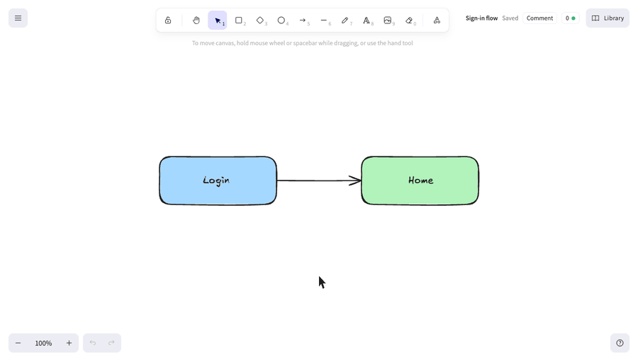
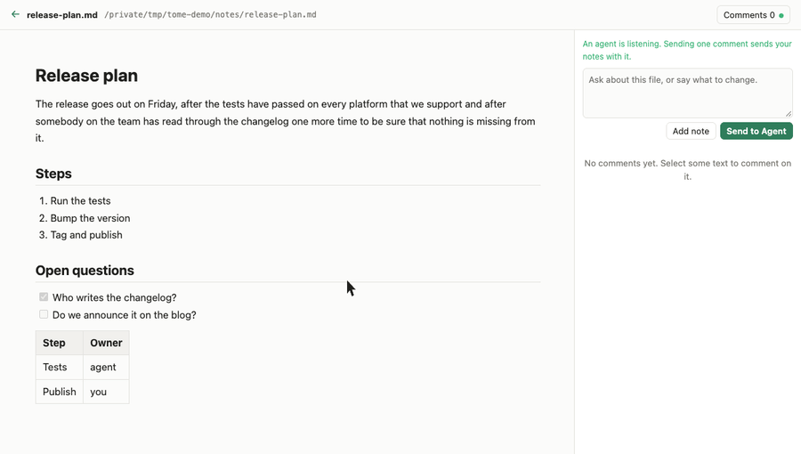

# tome-skill

English · [简体中文](README.zh-CN.md) · [日本語](README.ja.md)

Skills for coding agents, made for Agent Tome and usable without it. Each skill is a folder `skills/<name>/`: `SKILL.md` tells the agent how to use it, and `scripts/` holds the commands it runs. A skill starts a small page on your own computer; the agent hands you the address, you work in the browser, and the agent reads what you did and answers.

| skill | what it does |
| --- | --- |
| `tome-board` | A drawing board (Excalidraw): you and the agent draw on the same board in the browser, and the file is kept in your Obsidian vault |
| `tome-md` | Markdown: read a file rendered in the browser, select a passage to comment on or ask about, and the agent answers in the thread and edits the file |
| `tome-design` | A design: artboards written as plain HTML, side by side on a canvas in the browser; comment on an element or an area, and the agent changes the files and replies |
| `tome-slides` | A slide deck: one plain HTML file per slide, the slides with their speaker notes in the browser; present full screen with a speaker view, save a PDF or a PowerPoint file, comment on an element or an area, and the agent changes the files and replies |
| `tome-pipeline` | A pipeline: a folder of steps (scripts, prompts for an agent, questions for a person) with what each needs and makes; run it on a schedule or by hand, steps whose inputs did not change taken from the last run, a failed or waiting run carried on; a page draws the steps colored by their state, with each one's log and files |
| `tome-etl` | A dbt project as a graph: the models, sources, seeds and snapshots by who reads whom, one model's SQL, columns, tests and last results; models not written yet are plans drawn dashed, and the agent writes their files; a review names what lacks tests, a tested key or a description; comment on a model or a column, and the agent changes the SQL and YAML and replies |

## Install

Link the skill's folder into the place your agent reads skills from (for Claude Code, `~/.claude/skills/`):

```sh
ln -s "$PWD/skills/tome-board" ~/.claude/skills/tome-board
ln -s "$PWD/skills/tome-md" ~/.claude/skills/tome-md
ln -s "$PWD/skills/tome-design" ~/.claude/skills/tome-design
ln -s "$PWD/skills/tome-slides" ~/.claude/skills/tome-slides
ln -s "$PWD/skills/tome-pipeline" ~/.claude/skills/tome-pipeline
ln -s "$PWD/skills/tome-etl" ~/.claude/skills/tome-etl
```

`tome-md`, `tome-design`, `tome-slides`, `tome-pipeline` and `tome-etl` need no build: once linked, they work. The page of `tome-board` is built once (Node 20+):

```sh
cd apps/board && npm ci --ignore-scripts && node build.mjs
```

## tome-board: the drawing board



*You comment on a region; the agent changes the drawing and replies in the thread.*

`scripts/board.mjs` is both the command and the local server (Node 20+, no dependencies). `scripts/editor/` is the page, built from `apps/board` and not kept in git. The agent runs `open` and gives you the address.

```sh
node skills/tome-board/scripts/board.mjs open            # starts it if needed; prints {"url": "http://127.0.0.1:4740/", …}: the list of boards
node skills/tome-board/scripts/board.mjs open flow       # that board's address, file and png; no such board: an address where the page asks whether to make it
node skills/tome-board/scripts/board.mjs new flow        # makes an empty board and prints the two lines that attach it to a note
node skills/tome-board/scripts/board.mjs list
node skills/tome-board/scripts/board.mjs stop
node skills/tome-board/scripts/board.mjs comments --wait         # waits until you send a comment to the agent, prints that comment and ends
node skills/tome-board/scripts/board.mjs comment-reply <id> "…"  # replies (--resolve also closes it); comment-resolve <id> only closes it
```

- **Vault**: `--vault`. Without it, the script looks at `$TOME_BOARD_VAULT`, then the vault Agent Tome is set to (`config.json` in its home), then the nearest Obsidian vault above the current folder.
- **Files**: `<name>.excalidraw.md` in the vault's `Excalidraw/` folder (or the folder the Obsidian Excalidraw plugin is set to). It is the plugin's own format, so Obsidian opens the same file. The page saves 0.8 seconds after you stop drawing, and writes a picture of the whole board beside it, `<name>.png`, for the agent to look at.
- **The agent draws** by editing the `elements` in the file's `json` block. An open page shows the change at once, with a green frame around what changed (dismiss it with "N changed from outside" at the top right), and ⌘Z undoes it. The page then writes the file again in its own form and renews the picture.
- **Comments on a region**: press Comment at the top right, with shapes selected, or then drag over an area or click a shape, and write what to change or ask. While an agent runs `comments --wait` the button reads "Send to Agent" and the comment goes to it (your words, the region, the shapes in it, a picture of those shapes). Otherwise the comment is only saved, and the agent reads it with `comments`. The agent's reply shows under the comment. Comments are kept in `~/.tome-board/comments/`, not in the vault.
- **The list of boards** (`/`): the last changed first, search by name, "New board". The menu (☰) has "All boards", "Copy picture path" and "Copy file path".
- **One process per vault**, serving all of its boards. It listens on 127.0.0.1 only (4740, or the next free port up) and answers only requests addressed to this computer (`127.0.0.1` or `localhost`, at any port, since a port forwarded out of a container may differ), so a page of another site can neither read nor write. It touches only `.excalidraw.md`, `.excalidraw` and `.png` files in the board folder; writes are atomic and carry a revision.
- **The running process** is noted in `~/.tome-board/servers/<id>.json` (`$TOME_BOARD_HOME` moves it): `pid`, `url`, `port`, `root`, `kind: "board"`, `startedAt`. Agent Tome lists the board among its local pages from this file. After the script or the page is updated, the next `open` replaces the old process.
- **Tests**: `cd apps/board && npm test` (the file format, the page's translations, the server's rules).
- **Third-party licenses** (Excalidraw, the fonts, the packages) are in `scripts/editor/THIRD_PARTY_LICENSES.txt`, linked at the foot of the list of boards. Mermaid import and collaboration are left out.

## tome-md: Markdown



*You select a passage and comment; the agent edits the file and replies. Then a question about the whole file.*

`scripts/md.mjs` is both the command and the local server (Node 20+, no dependencies). `scripts/page/` is the page: plain JavaScript, no build. Markdown is parsed by the copy of marked shipped beside it (its license: `scripts/page/vendor/marked.LICENSE.md`).

```sh
node skills/tome-md/scripts/md.mjs open notes.md       # starts it if needed; prints {"url": "http://127.0.0.1:4750/d/<id>", …}
node skills/tome-md/scripts/md.mjs open                # the page that lists the opened files
node skills/tome-md/scripts/md.mjs list
node skills/tome-md/scripts/md.mjs close notes.md      # takes it off the list (the file stays)
node skills/tome-md/scripts/md.mjs stop
node skills/tome-md/scripts/md.mjs comments --wait         # waits until you send a comment to the agent, prints that comment and ends
node skills/tome-md/scripts/md.mjs comment-reply <id> "…"  # replies (--resolve also closes it); comment-resolve <id> only closes it
```

- **The page reads the file and never writes it.** You edit it in your own editor, the agent edits the file directly. When the file changes the page shows it at once, with a green bar beside the new and rewritten blocks (dismiss it with "N changed" at the top right).
- **Comments**: select some text and press Comment, or write about the whole file in the box at the top of the panel. "Add note" keeps a comment without sending it. While an agent runs `comments --wait` there is also "Send to Agent", which hands it this comment together with the notes added before it on that file (your words, the selected text, its lines, the heading it is under). When no agent is waiting, notes are only saved, and the agent reads them with `comments`. The agent's reply shows under the comment.
- **Only files opened with `open`** are shown (`.md`, `.markdown`); the page has no way to open another file. Pictures show when they are files beside the Markdown file (in the same vault or repository, not in a hidden folder); pictures on the web are not loaded. HTML written in the file is shown as text, not run.
- **One process per computer.** It listens on 127.0.0.1 only (4750, or the next free port up) and, like the board, answers only requests addressed to this computer.
- **Its own notes** are all in `~/.tome-md/` (`$TOME_MD_HOME` moves it): the opened files, the running process (`servers/main.json`, `kind: "md"`), the comments.
- **Tests**: `cd apps/md && npm test`.

## tome-design: a design on a canvas

`scripts/design.mjs` is both the command and the local server (Node 20+, no dependencies). `scripts/page/` is the page: plain JavaScript, no build. A design is a folder: `design.json` places its artboards on the canvas, and each artboard is a plain HTML file in the folder.

```sh
node skills/tome-design/scripts/design.mjs new "Sign-in flow"     # makes designs/Sign-in flow/ with an empty design.json, opens it; prints {"url": "http://127.0.0.1:4760/d/<id>", …}
node skills/tome-design/scripts/design.mjs open "designs/Sign-in flow"   # --board Home.html: that board alone
node skills/tome-design/scripts/design.mjs open             # the page that lists the opened designs
node skills/tome-design/scripts/design.mjs check "designs/Sign-in flow"  # what is wrong in design.json and the boards' HTML; exits 1 while anything is
node skills/tome-design/scripts/design.mjs list
node skills/tome-design/scripts/design.mjs close "designs/Sign-in flow"
node skills/tome-design/scripts/design.mjs stop
node skills/tome-design/scripts/design.mjs comments --wait         # waits until you send a comment to the agent, prints that comment and ends
node skills/tome-design/scripts/design.mjs comment-reply <id> "…"  # replies (--resolve also closes it); comment-resolve <id> only closes it
```

- **The canvas**: every board at its own size, its name above it. Drag or scroll to move, pinch or ⌘ + scroll to zoom, F fits everything, 0 is 100%. Double-click a board to see it alone, at full length, with its links and scripts working (‹ › or ← → for the others, Esc back).
- **Presenting** (Present, or P): one board at a time in the whole window, like a clickable prototype. A link to another board (`<a href="Home.html">`) goes there, the new board sliding in from the side (`data-transition="up"`, `"fade"` or `"none"` on the link for another way); a click on anything else flashes where the links are. C comments there too, with the panel beside the board. ← → for the boards in order, Backspace back, R from the start, Esc to end. `open <folder> --present <file>` prints the address of a presentation that starts there.
- **The agent writes the files** and the open page follows: a changed board reloads at once and is outlined in green (dismiss it with "N changed" at the top right). The page itself edits nothing.
- **Comments**: press Comment (or C), then click an element of a board or drag over an area of it, and write. "Add note" keeps it; "Send to Agent" (while an agent runs `comments --wait`) hands it over with the notes before it. The agent gets the board, the place in its px, and the element (a CSS path, its text and the start of its markup) or the elements in the area. The box at the top of the panel is about the whole design.
- **Boards run in a sandbox**: another origin for each, with no access to the page, to this server's calls or to the network. They load files from their own folder and Google Fonts only.
- **One process per computer.** It listens on 127.0.0.1 only (4760, or the next free port up) and answers only requests addressed to this computer. Its own notes are in `~/.tome-design/` (`$TOME_DESIGN_HOME` moves it): the opened designs, the running process (`servers/main.json`, `kind: "design"`), the comments.
- **Not the claude-design format**: its `.dc.html` files need that skill's runtime. A tome-design board is an ordinary HTML file you can also open on its own.
- **Tests**: `cd apps/design && npm test`.

## tome-slides: a slide deck

`scripts/slides.mjs` is both the command and the local server (Node 20+, no dependencies; Chrome only for `export`). `scripts/page/` is the page: plain JavaScript, no build. A deck is a folder: `deck.json` lists the slides in order with their speaker notes, and each slide is a plain HTML file in the folder.

```sh
node skills/tome-slides/scripts/slides.mjs new "Q3 review"          # makes decks/Q3 review/ with an empty deck.json, opens it; prints {"url": "http://127.0.0.1:4770/d/<id>", …}
node skills/tome-slides/scripts/slides.mjs open "decks/Q3 review"   # --slide 3: that slide; --present 1: a presentation from there
node skills/tome-slides/scripts/slides.mjs open                     # the page that lists the opened decks
node skills/tome-slides/scripts/slides.mjs check "decks/Q3 review"  # what is wrong in deck.json and the slides' HTML; exits 1 while anything is
node skills/tome-slides/scripts/slides.mjs export "decks/Q3 review" --pdf   # one PDF in the folder's exports/; --pptx: PowerPoint; --png: a picture per slide
node skills/tome-slides/scripts/slides.mjs list
node skills/tome-slides/scripts/slides.mjs close "decks/Q3 review"
node skills/tome-slides/scripts/slides.mjs stop
node skills/tome-slides/scripts/slides.mjs comments --wait          # waits until you send a comment to the agent, prints that comment and ends
node skills/tome-slides/scripts/slides.mjs comment-reply <id> "…"   # replies (--resolve also closes it); comment-resolve <id> only closes it
```

- **The deck**: the slides in a row down the side, the chosen one large, its speaker notes under it. ← → (or ↑ ↓) go through them.
- **Presenting** (Present, or P; Shift+P from the first slide): full screen, one slide at a time. → , Space or a click goes on, ← back, Home and End to the ends, B blacks the screen, Esc ends. Elements with `data-step="1"`, `"2"`… appear one press at a time. A slide comes in with a fade, a slide from the side, or at once (`transition` in `deck.json`, for the deck or one slide). S opens the speaker view in another window: the slide now, what comes next, the notes in large type, a timer and the clock; its keys move the presentation too. C comments there, with the panel beside the slide.
- **PDF**: Export PDF in the page (or `export --pdf`) makes `exports/<title>.pdf`, every slide a page of the deck's size, through a headless Chrome, and the page downloads it. Without Chrome, the button opens the print dialog (Save as PDF).
- **PowerPoint**: Export PPTX in the page (or `export --pptx`) makes `exports/<title>.pptx`: each slide a picture of it, with its speaker notes and transition. It plays in PowerPoint and Keynote as it looks in the browser, but its text can not be edited there.
- **The agent writes the files** and the open page follows: a changed slide reloads at once and is outlined in green. The page itself edits nothing.
- **Comments**: press Comment (or C), then click an element of the slide or drag over an area of it, and write. "Add note" keeps it; "Send to Agent" (while an agent runs `comments --wait`) hands it over with the notes before it. The agent gets the slide and its number, the place in its px, and the element or the elements in the area. The box at the top of the panel is about the whole deck.
- **Slides run in a sandbox**, as tome-design's boards do: they load files from their own folder and Google Fonts only.
- **One process per computer.** It listens on 127.0.0.1 only (4770, or the next free port up). Its own notes are in `~/.tome-slides/` (`$TOME_SLIDES_HOME` moves it): the opened decks, the running process (`servers/main.json`, `kind: "slides"`), the comments.
- **Not the claude-slides format** (`project/deck.json` with a closed subset of inline styles): a tome-slides slide is an ordinary HTML page, any CSS, and opens on its own. The PowerPoint file it makes is pictures, not editable text.
- **Tests**: `cd apps/slides && npm test`.

## tome-pipeline: a pipeline of steps

`scripts/pipeline.mjs` is the command, the runner and the local server (Node 20+, no dependencies). `scripts/page/` is the page: plain JavaScript, no build. A pipeline is a folder: `pipeline.json` lists the steps with what each needs and makes, and each step is a script or a prompt in `steps/`. Every run is a folder `runs/<time>/` with each step's log and files.

```sh
node skills/tome-pipeline/scripts/pipeline.mjs new "Daily news"          # makes pipelines/Daily news/ (pipeline.json, steps/, a .gitignore for runs/), opens it; prints {"url": "http://127.0.0.1:4780/p/<id>", …}
node skills/tome-pipeline/scripts/pipeline.mjs check "pipelines/Daily news"   # what is wrong in pipeline.json, and which steps are not written yet
node skills/tome-pipeline/scripts/pipeline.mjs run "pipelines/Daily news"     # one run; --only <step>: that step alone; --all: take nothing from earlier runs
node skills/tome-pipeline/scripts/pipeline.mjs resume "pipelines/Daily news"  # carry the latest run on; --from <step>: that step and the ones after it again
node skills/tome-pipeline/scripts/pipeline.mjs answer "pipelines/Daily news" pick "…" --resume   # answer a question that waits, and carry the run on
node skills/tome-pipeline/scripts/pipeline.mjs status "pipelines/Daily news"
node skills/tome-pipeline/scripts/pipeline.mjs schedule "pipelines/Daily news" --cron "0 6 * * *"   # prints the command a scheduled job runs
node skills/tome-pipeline/scripts/pipeline.mjs open | list | close <folder> | stop
```

- **Three kinds of step**: `sh` runs a script of the folder (or a shell command) in its own folder of the run, with the folders of the steps it needs in `$IN_<ID>`; `agent` hands a Markdown prompt to `claude -p` (or another command, such as `codex exec`) with where its inputs are and which files to write; `human` asks a person a question, its choices the lines of a file a step before it made.
- **A run** goes in the order of the steps' needs, side by side where it can (`parallel`, 4 by default), with `retry` and `timeout` per step. A step whose definition, script or prompt, and inputs did not change is taken from an earlier run (its files linked in) instead of run again; `fresh: true` for a step that reads the outside world.
- **How it ends**: one last line, `DONE …`, `FAIL … · <step> · <why> · log <path>` or `WAIT … · <step> waits for a person`, and the exit code 0, 1 or 3 (4: the pipeline runs already). `resume` carries a failed, waiting or interrupted run on in the same folder.
- **Not a daemon, not a scheduler**: the process carries one run and ends. Bot Tome, launchd, cron or CI starts it; whoever started it reads the exit code and the last line.
- **The page**: the steps as a graph colored by their state in a run (dashed: not written yet), a run picked at the top. A click on a step shows its definition, its log, and its files: pictures, sound and video play, text shows, CSV and TSV as a table. A question that waits can be answered there, and the run goes on.
- **One process per computer** for the page. It listens on 127.0.0.1 only (4780, or the next free port up). Its own notes are in `~/.tome-pipeline/` (`$TOME_PIPELINE_HOME` moves it): the opened pipelines and the running process (`servers/main.json`, `kind: "pipeline"`).
- **Tests**: `cd apps/pipeline && npm test`.

## tome-etl: a dbt project as a graph

`scripts/etl.mjs` is both the command and the local server (Node 20+, no dependencies). `scripts/page/` is the page: plain JavaScript, no build. It reads what dbt wrote in the project's `target/` folder and never the warehouse.

```sh
node skills/tome-etl/scripts/etl.mjs open path/to/project          # starts it if needed; prints {"url": "http://127.0.0.1:4790/p/<id>", …}; --select orders: that model and what is around it
node skills/tome-etl/scripts/etl.mjs parse path/to/project         # runs `dbt parse` there (it connects to nothing), so target/manifest.json is new
node skills/tome-etl/scripts/etl.mjs status path/to/project        # dbt's version, when it was parsed, whether files changed since, counts
node skills/tome-etl/scripts/etl.mjs models path/to/project --select "+orders+1"   # a line per model; + before / after as in dbt
node skills/tome-etl/scripts/etl.mjs show path/to/project orders   # one model: its files, columns, tests and their last result, what it reads, who reads it
node skills/tome-etl/scripts/etl.mjs review path/to/project        # what the models lack
node skills/tome-etl/scripts/etl.mjs check path/to/project         # tome-etl.json: what is wrong, what a plan leaves open, which plans are written
node skills/tome-etl/scripts/etl.mjs scaffold path/to/project      # writes the .sql and .yml of the plans not written yet; never over a file
node skills/tome-etl/scripts/etl.mjs open | list | close <project> | stop
node skills/tome-etl/scripts/etl.mjs comments --wait         # waits until you send a comment to the agent, prints that comment and ends
node skills/tome-etl/scripts/etl.mjs comment-reply <id> "…"  # replies (--resolve also closes it); comment-resolve <id> only closes it
```

- **What it reads**: `target/manifest.json` (from `dbt parse`: the models, what each reads, columns, tests, SQL), and when they are there `run_results.json` (each model's and test's last result), `catalog.json` (column types and row counts, from `dbt docs generate`) and `sources.json` (freshness). Manifests of dbt 1.4, 1.7 and 1.12 are among its tests; it parses no Jinja and no SQL itself.
- **The only dbt command it runs is `dbt parse`.** Running, testing and building are left to you or the agent, against a development target. dbt is started as `tome-etl.json`'s `"dbt"` says, else `$TOME_ETL_DBT`, else the project's `.venv/bin/dbt`, else `dbt`.
- **The page**: the list of models on the left (search, folder, tag; a Review tab), the graph in the middle, the chosen model under it (files, key, columns with their tests, last run, SQL as written and compiled, tests), the comments on the right. A small project is drawn whole with the chosen model's way in and out highlighted; a large one shows the chosen model with 1, 2, 3 or all levels around it, so thousands of models stay usable.
- **Plans**: a model or a source that is not written yet is an entry in the project's `tome-etl.json` (what one row is, its key, what it reads, how it is materialized, its columns and tests). It is drawn dashed among the real models. `scaffold` writes its `.sql` (inputs as CTEs, config, the watermark of an incremental model) and `.yml` (description, columns, tests on the key); once `dbt parse` knows the model, the plan is done.
- **Review**: models with no tests, no test of their key, a `unique_key` no test covers, a column tested unique but not not_null, no description, incremental without a `unique_key`, a source without freshness. Read from the manifest, not from the data.
- **Comments**: select a model and press Comment, or the ＋ beside a column. "Add note" keeps it; "Send to Agent" (while an agent runs `comments --wait`) hands it over with the notes before it. The agent gets the model, the column, and the paths of the SQL and the YAML to change.
- **Not here**: column-level lineage, a diff of two branches' data, query preview (dbt's VS Code extension, Power User for dbt and Recce do those), and Dataform.
- **One process per computer.** It listens on 127.0.0.1 only (4790, or the next free port up). Its own notes are in `~/.tome-etl/` (`$TOME_ETL_HOME` moves it): the opened projects, the running process (`servers/main.json`, `kind: "etl"`), the comments.
- **Tests**: `cd apps/etl && npm test`.

## License

MIT, see [LICENSE](LICENSE).
