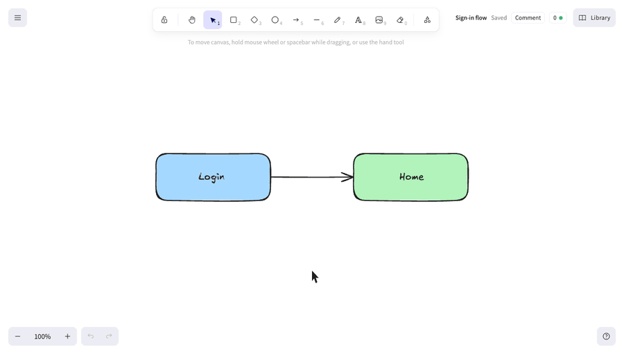
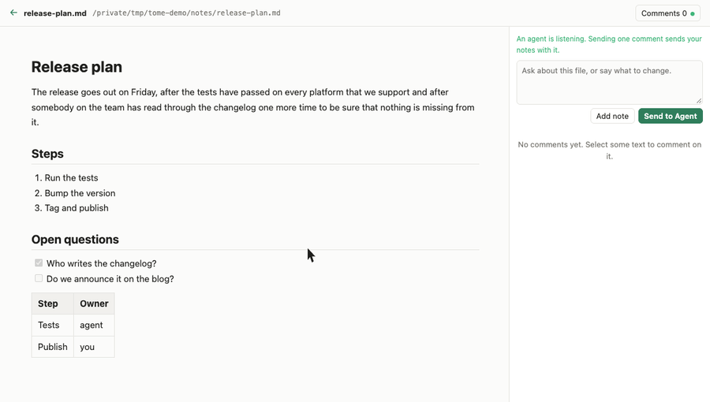
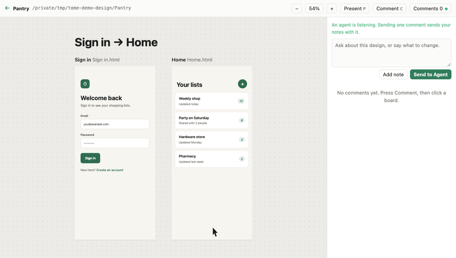
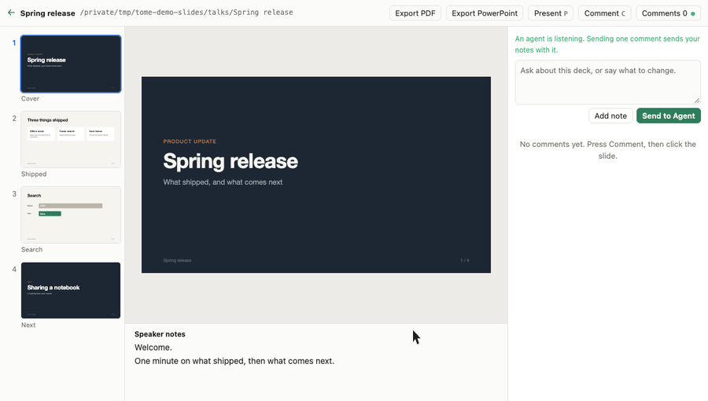
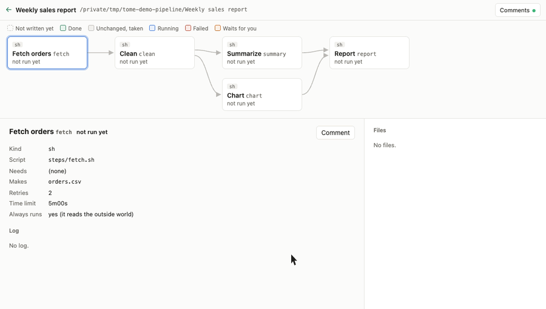
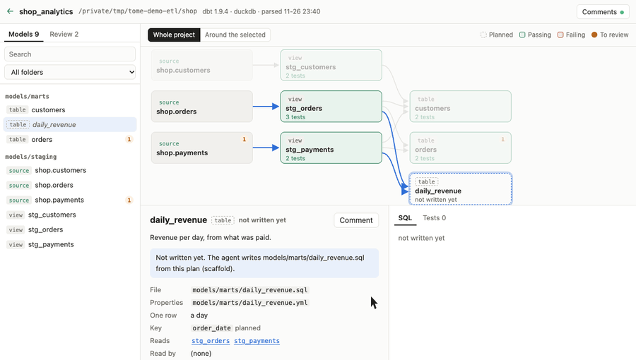

# tome-skill

[English](README.md) · 简体中文 · [日本語](README.ja.md)

Agent Tome 的 skill。每个 skill 是 `skills/<名字>/`：`SKILL.md` 告诉 agent 怎么用，`scripts/` 是它跑的命令。skill 不在 Agent Tome 的应用里，也不在 `tomed` 里，不装 Agent Tome 也能单独用。

| skill | 做什么 |
| --- | --- |
| `tome-board` | 画板（Excalidraw）：在浏览器里和 agent 一起画，文件存在 Obsidian 卡片库里 |
| `tome-md` | Markdown：在浏览器里看渲染好的文档，选中一段评论或提问，agent 在评论下面回答、改文件 |
| `tome-design` | 设计稿：画板写成普通的 HTML，在浏览器里的画布上并排看；点一个元素或框一块区域评论，agent 改文件、在评论下面回答 |
| `tome-slides` | 幻灯片：一页一个普通的 HTML 文件，在浏览器里看幻灯片和演讲备注；全屏演示、演讲者视图、存成 PDF 或 PowerPoint；点一个元素或框一块区域评论，agent 改文件、在评论下面回答 |
| `tome-pipeline` | 流水线：一个文件夹里的几步（脚本、给 agent 的提示词、问人的问题），每步写明需要什么、产出什么；定时或手动跑，输入没变的步骤直接用上次的结果，失败或等人的那次运行能接着跑；页面上按状态给每一步上色，看每步的日志和产出 |
| `tome-etl` | 把 dbt 项目看成一张图：模型、来源、seed、snapshot 按谁读谁排开，点一个模型看它的 SQL、列、测试和最近的结果；还没写的模型是计划，画成虚线，由 agent 生成文件；检视会指出缺测试、缺主键测试、缺说明的模型；对模型或某一列评论，agent 改 SQL 和 YAML 并回复 |

## 安装

把 skill 的文件夹链接到 agent 放 skill 的地方（Claude Code 是 `~/.claude/skills/`）：

```sh
ln -s "$PWD/skills/tome-board" ~/.claude/skills/tome-board
ln -s "$PWD/skills/tome-md" ~/.claude/skills/tome-md
ln -s "$PWD/skills/tome-design" ~/.claude/skills/tome-design
ln -s "$PWD/skills/tome-slides" ~/.claude/skills/tome-slides
ln -s "$PWD/skills/tome-pipeline" ~/.claude/skills/tome-pipeline
ln -s "$PWD/skills/tome-etl" ~/.claude/skills/tome-etl
```

`tome-md`、`tome-design`、`tome-slides`、`tome-pipeline` 和 `tome-etl` 不用构建，链接上就能用。`tome-board` 的页面要先构建一次（Node 20+）：

```sh
cd apps/board && npm ci --ignore-scripts && node build.mjs
```

## tome-board：画板



*框选一块区域写评论，agent 改图并在评论下面回复。（演示画面是英文界面，页面会跟随浏览器的语言。）*

和 claude slides・claude design 同一种做法：`scripts/board.mjs` 是命令和本机服务（Node 20+，没有依赖），`scripts/editor/` 是页面（从 `apps/board` 构建，不进 git）。agent 跑 `open` 拿到地址交给人。

```sh
node skills/tome-board/scripts/board.mjs open          # 没在跑就启动，打印 {"url": "http://127.0.0.1:4740/", …}：画板库
node skills/tome-board/scripts/board.mjs open 流程图    # 这张画板的地址、文件、png；没有这张就给出页面上问要不要创建的地址
node skills/tome-board/scripts/board.mjs new 流程图     # 新建一张空的，并给出挂到卡片上的两行
node skills/tome-board/scripts/board.mjs list
node skills/tome-board/scripts/board.mjs stop
node skills/tome-board/scripts/board.mjs comments --wait        # 等人在页面上把评论发给 agent，打印那条评论后结束
node skills/tome-board/scripts/board.mjs comment-reply <id> "…"  # 回复（--resolve 同时关掉）；comment-resolve <id> 只关掉
```

- 卡片库：`--vault`，没给就按 `$TOME_BOARD_VAULT`、Agent Tome 设的卡片库（home 的 `config.json`）、当前文件夹往上找到的 Obsidian 库的顺序找。
- 文件：卡片库的 `Excalidraw/`（Obsidian 的 Excalidraw 插件设了别的文件夹就跟它走）里的 `<名字>.excalidraw.md`，和插件同一种格式，两边都能开。停笔 0.8 秒自动保存，同时在旁边写一张整张图的 `<名字>.png`（给 agent 看的）。
- agent 直接改 `.excalidraw.md` 里 ```json 的 elements，开着的页面马上换新，改过的元素描绿框（右上角「外部改了 N 处」点掉），⌘Z 能撤回；页面随后按自己的格式重写一遍并更新 png。
- 区域评论：页面右上角「评论」。先选中图形再点，或者点了之后拖一块区域・点一个图形，写要怎么改或提问。有 agent 在跑 `comments --wait` 时按钮是「发给 Agent」，那条评论（文字、区域、里面的图形、图形的截图）交给它；没有就只保存，agent 用 `comments` 读。agent 的回复显示在评论下面。评论不放在卡片库里，在 `~/.tome-board/comments/`。
- 画板库（`/`）：最近改过的在前，按名字搜，「新画板」。菜单（☰）里有「全部画板」「复制图片路径」「复制文件路径」。
- 一个卡片库一个进程，管这个库的全部画板。只听 127.0.0.1（默认 4740，被占就往上找）。只接受发给这台机器（`127.0.0.1`・`localhost`，端口不限：容器转发出来的端口可能不一样）的请求，别的网站的页面读不到也写不了；只碰画板文件夹里的 `.excalidraw.md`・`.excalidraw`・`.png`，写入是原子的、带 rev。
- 在跑的进程记在 `~/.tome-board/servers/<id>.json`（`$TOME_BOARD_HOME` 可以换地方）：`pid`・`url`・`port`・`root`・`kind: "board"`・`startedAt`，和 claude slides・design 写在各自文件夹里的 `.artifact-server.json` 同样的字段。Agent Tome 的「本机页面」靠它列出画板。脚本或页面更新后下一次 `open` 会换成新的进程。
- 测试：`cd apps/board && npm test`（文件格式・文字的翻译・服务的规则）。
- 第三方许可（Excalidraw、字体、依赖）在 `scripts/editor/THIRD_PARTY_LICENSES.txt`，画板库页面最下面有链接。不带 Mermaid 导入和协作。

## tome-md：Markdown



*选中一段文字写评论，agent 改文件并回复；接着对整篇文档提问。（演示画面是英文界面，页面会跟随浏览器的语言。）*

`scripts/md.mjs` 是命令和本机服务（Node 20+，没有依赖），`scripts/page/` 是页面（原生 JS，不用构建；Markdown 的解析用随附的 marked，许可在 `scripts/page/vendor/marked.LICENSE.md`）。

```sh
node skills/tome-md/scripts/md.mjs open 笔记.md        # 没在跑就启动，打印 {"url": "http://127.0.0.1:4750/d/<id>", …}
node skills/tome-md/scripts/md.mjs open               # 打开过的文件的列表页
node skills/tome-md/scripts/md.mjs list
node skills/tome-md/scripts/md.mjs close 笔记.md       # 从列表里拿掉（文件不动）
node skills/tome-md/scripts/md.mjs stop
node skills/tome-md/scripts/md.mjs comments --wait        # 等人在页面上把评论发给 agent，打印那条评论后结束
node skills/tome-md/scripts/md.mjs comment-reply <id> "…"  # 回复（--resolve 同时关掉）；comment-resolve <id> 只关掉
```

- 页面只读文件，不改。人用自己的编辑器改，agent 直接改文件；文件一变页面马上换新，新的和改过的段落左边描绿（右上角「改了 N 处」点掉）。
- 评论：选中一段文字点「评论」，或者在右边面板最上面的框里对整篇文档说话。「添加注释」只存下来不发；有 agent 在跑 `comments --wait` 时旁边多一个「发给 Agent」，把这一条和这个文件里之前加的注释一起交给它（文字、选中的原文、所在的行、所在的标题）。没有 agent 在等时注释只保存，agent 用 `comments` 读。agent 的回复显示在评论下面。
- 只显示用 `open` 打开过的文件（`.md`・`.markdown`），页面上没有打开别的文件的入口。图片只显示文件旁边的（同一个卡片库或仓库里、不在隐藏文件夹里），网上的图片不加载；文件里写的 HTML 当文字显示，不执行。
- 一台机器一个进程。只听 127.0.0.1（默认 4750，被占就往上找），和画板一样只接受发给这台机器的请求。
- 自己的记录都在 `~/.tome-md/`（`$TOME_MD_HOME` 可以换地方）：打开过的文件、在跑的进程（`servers/main.json`，`kind: "md"`）、评论。
- 测试：`cd apps/md && npm test`。

## tome-design：画布上的设计稿



*点画板上的一个元素写评论，agent 改 HTML 文件并回复；画布上改过的画板会被框出来，接着演示、点着往下走。（演示画面是英文界面，页面会跟随浏览器的语言。）*

`scripts/design.mjs` 既是命令也是本机的服务（Node 20+，没有依赖）。`scripts/page/` 是页面：普通的 JavaScript，不用构建。一个设计稿是一个文件夹：`design.json` 写画板在画布上的位置，每张画板是文件夹里的一个普通 HTML 文件。

```sh
node skills/tome-design/scripts/design.mjs new "登录流程"          # 建 designs/登录流程/ 和空的 design.json，打开它；打印 {"url": "http://127.0.0.1:4760/d/<id>", …}
node skills/tome-design/scripts/design.mjs open designs/登录流程   # --board Home.html：单独看那一张
node skills/tome-design/scripts/design.mjs open                    # 打开过的设计稿的列表
node skills/tome-design/scripts/design.mjs check designs/登录流程  # design.json 和画板 HTML 里的问题；有问题时退出码 1
node skills/tome-design/scripts/design.mjs list
node skills/tome-design/scripts/design.mjs close designs/登录流程
node skills/tome-design/scripts/design.mjs stop
node skills/tome-design/scripts/design.mjs comments --wait         # 等你把评论发给 agent，打印那条评论后结束
node skills/tome-design/scripts/design.mjs comment-reply <id> "…"  # 回复（--resolve 同时解决）；comment-resolve <id> 只解决
```

- **画布**：每张画板按自己的尺寸摆着，上面是名字。拖动或滚动移动，双指捏合或 ⌘＋滚动缩放，F 看全部，0 回到 100%。双击一张单独看：完整的长度，链接和脚本都能用（‹ › 或 ← → 换一张，Esc 回去）。
- **演示**（「演示」或 P）：整个窗口一次一张，像能点的原型。指向别的画板的链接（`<a href="Home.html">`）点了就跳过去，新的一张从侧面滑进来（链接上写 `data-transition="up"`、`"fade"`、`"none"` 换别的方式）；点别处会闪出能点的地方。演示时也能按 C 评论，评论面板在画板旁边。← → 按顺序换，Backspace 回上一张，R 从头，Esc 结束。`open <文件夹> --present <文件>` 打印从那一张开始的演示地址。
- **文件由 agent 写**，开着的页面跟着变：改了的画板马上重新载入、描绿框（右上「改了 N 张」点掉）。页面本身不改任何东西。
- **评论**：按「评论」（或 C），再点画板里的一个元素或拖出一块区域，写下要说的。「添加注释」先存着；agent 在跑 `comments --wait` 时「发给 Agent」连同之前的注释一起交给它。agent 拿到的是画板、画板里的位置（px）、点的元素（CSS 路径、文字、开头一段标记）或区域里的元素。面板最上面的框是对整个设计稿说的。
- **画板在沙箱里跑**：每张是另一个源，碰不到页面、服务的接口和网络。只能加载自己文件夹里的文件和 Google Fonts。
- **一台电脑一个进程。** 只听 127.0.0.1（4760，被占了就往上找），只回应发给这台电脑的请求。自己的记录都在 `~/.tome-design/`（`$TOME_DESIGN_HOME` 可以改）：打开过的设计稿、在跑的进程（`servers/main.json`，`kind: "design"`）、评论。
- **不是 claude-design 的格式**：它的 `.dc.html` 要那个 skill 的运行时。tome-design 的画板是普通的 HTML，单独也能打开。
- **测试**：`cd apps/design && npm test`。

## tome-slides：幻灯片



*点一下幻灯片上的一个元素写评论，agent 改这一页的文件并回复；接着放映，按一下翻一页。（演示画面是英文界面，页面会跟随浏览器的语言。）*

`scripts/slides.mjs` 既是命令也是本机的服务（Node 20+，没有依赖；只有 `export` 要用 Chrome）。`scripts/page/` 是页面：普通的 JavaScript，不用构建。一套幻灯片是一个文件夹：`deck.json` 按顺序列出每一页和它的演讲备注，每一页是文件夹里的一个普通 HTML 文件。

```sh
node skills/tome-slides/scripts/slides.mjs new "季度回顾"          # 建 decks/季度回顾/ 和空的 deck.json，打开它；打印 {"url": "http://127.0.0.1:4770/d/<id>", …}
node skills/tome-slides/scripts/slides.mjs open decks/季度回顾     # --slide 3：第 3 页；--present 1：从那一页开始演示
node skills/tome-slides/scripts/slides.mjs open                    # 打开过的幻灯片的列表
node skills/tome-slides/scripts/slides.mjs check decks/季度回顾    # deck.json 和每页 HTML 里的问题；有问题时退出码 1
node skills/tome-slides/scripts/slides.mjs export decks/季度回顾 --pdf   # 在文件夹的 exports/ 里出一个 PDF；--pptx：PowerPoint；--png：每页一张图
node skills/tome-slides/scripts/slides.mjs list
node skills/tome-slides/scripts/slides.mjs close decks/季度回顾
node skills/tome-slides/scripts/slides.mjs stop
node skills/tome-slides/scripts/slides.mjs comments --wait         # 等你把评论发给 agent，打印那条评论后结束
node skills/tome-slides/scripts/slides.mjs comment-reply <id> "…"  # 回复（--resolve 同时解决）；comment-resolve <id> 只解决
```

- **看幻灯片**：左边一列是所有页，中间大的是选中的那页，下面是它的演讲备注。← →（或 ↑ ↓）翻页。
- **演示**（「演示」或 P；Shift+P 从第一页）：全屏，一次一页。→、空格或点一下往下，← 往回，Home、End 到头尾，B 黑屏，Esc 结束。写了 `data-step="1"`、`"2"`… 的元素按一次出一个。换页是淡入、从侧面滑进来或直接换（`deck.json` 的 `transition`，整套或单页）。S 在另一个窗口开演讲者视图：当前页、下一步、大字的备注、计时和时钟；在那边按键也能翻页。演示时也能按 C 评论，评论面板在幻灯片旁边。
- **PDF**：页面上的「导出 PDF」（或 `export --pdf`）用无界面的 Chrome 出 `exports/<标题>.pdf`，每页和幻灯片一样大，页面再把它下载下来。没有 Chrome 时，按钮改为打开打印对话框（选「存为 PDF」）。
- **PowerPoint**：页面上的「导出 PPTX」（或 `export --pptx`）出 `exports/<标题>.pptx`：每页是一张图，带演讲备注和转场。在 PowerPoint、Keynote 里放出来和浏览器里一样，但文字不能在那里改。
- **文件由 agent 写**，开着的页面跟着变：改了的页马上重新载入、描绿框。页面本身不改任何东西。
- **评论**：按「评论」（或 C），再点幻灯片里的一个元素或拖出一块区域，写下要说的。「添加注释」先存着；agent 在跑 `comments --wait` 时「发给 Agent」连同之前的注释一起交给它。agent 拿到的是哪一页（第几页）、页里的位置（px）、点的元素或区域里的元素。面板最上面的框是对整套幻灯片说的。
- **每页在沙箱里跑**，和 tome-design 的画板一样：只能加载自己文件夹里的文件和 Google Fonts。
- **一台电脑一个进程。** 只听 127.0.0.1（4770，被占了就往上找）。自己的记录都在 `~/.tome-slides/`（`$TOME_SLIDES_HOME` 可以改）：打开过的幻灯片、在跑的进程（`servers/main.json`，`kind: "slides"`）、评论。
- **不是 claude-slides 的格式**（`project/deck.json`，只能用一部分行内样式）：tome-slides 的每一页是普通的 HTML，CSS 随便写，单独也能打开。出的 PowerPoint 是图片，文字不能编辑。
- **测试**：`cd apps/slides && npm test`。

## tome-pipeline：流水线



*运行时每一步按状态变色；点开一步看日志和产出的文件，回答停下来等人的问题，流水线接着跑完。（演示画面是英文界面，页面会跟随浏览器的语言。）*

`scripts/pipeline.mjs` 既是命令、运行器，也是本机的服务（Node 20+，没有依赖）。`scripts/page/` 是页面：普通的 JavaScript，不用构建。一条流水线是一个文件夹：`pipeline.json` 列出每一步和它需要什么、产出什么，每一步是 `steps/` 里的一个脚本或提示词。每次运行是一个文件夹 `runs/<时间>/`，放着每一步的日志和产出。

```sh
node skills/tome-pipeline/scripts/pipeline.mjs new "每日新闻"           # 建 pipelines/每日新闻/（pipeline.json、steps/、忽略 runs/ 的 .gitignore），打开它；打印 {"url": "http://127.0.0.1:4780/p/<id>", …}
node skills/tome-pipeline/scripts/pipeline.mjs check pipelines/每日新闻   # pipeline.json 里的问题，和哪些步骤还没写
node skills/tome-pipeline/scripts/pipeline.mjs run pipelines/每日新闻     # 跑一次；--only <步骤>：只跑这一步；--all：不用以前的结果
node skills/tome-pipeline/scripts/pipeline.mjs resume pipelines/每日新闻  # 最近一次接着跑；--from <步骤>：这一步和后面的重跑
node skills/tome-pipeline/scripts/pipeline.mjs answer pipelines/每日新闻 pick "…" --resume   # 回答等着的问题，然后接着跑
node skills/tome-pipeline/scripts/pipeline.mjs status pipelines/每日新闻
node skills/tome-pipeline/scripts/pipeline.mjs schedule pipelines/每日新闻 --cron "0 6 * * *"   # 打印定时任务要执行的命令
node skills/tome-pipeline/scripts/pipeline.mjs open | list | close <文件夹> | stop
```

- **三种步骤**：`sh` 在这次运行里它自己的文件夹中跑文件夹里的脚本（或一行 shell 命令），它需要的步骤的文件夹在 `$IN_<ID>`；`agent` 把 Markdown 提示词交给 `claude -p`（或别的命令，比如 `codex exec`），并告诉它输入在哪、要写哪些文件；`human` 问人一个问题，选项是前面某一步产出的文件里的每一行。
- **一次运行**按步骤的依赖顺序走，能并行的一起跑（`parallel`，默认 4），每步可以设 `retry` 和 `timeout`。定义、脚本或提示词、输入都没变的步骤，直接用以前那次的结果（把文件链接进来），不再跑；读外面的东西的步骤写 `fresh: true`。
- **怎么结束**：最后一行 `DONE …`、`FAIL … · <步骤> · <原因> · log <路径>` 或 `WAIT … · <步骤> waits for a person`，退出码 0、1 或 3（4：这条流水线已经在跑）。`resume` 在同一个文件夹里把失败、等人或中断的运行接着跑。
- **不是守护进程，也不是定时器**：进程跑完一次就结束。由 Bot Tome、launchd、cron 或 CI 来启动；谁启动的谁看退出码和最后一行。
- **页面**：步骤按依赖画成图，按某次运行里的状态上色（虚线：还没写），上面可以换一次运行。点一步看它的定义、日志和产出：图、音频、视频直接放，文字直接显示，CSV、TSV 显示成表格。等人回答的问题可以在页面上回答，回答后流水线接着跑。
- **页面一台电脑一个进程。** 只听 127.0.0.1（4780，被占了就往上找）。自己的记录在 `~/.tome-pipeline/`（`$TOME_PIPELINE_HOME` 可以改）：打开过的流水线、在跑的进程（`servers/main.json`，`kind: "pipeline"`）。
- **测试**：`cd apps/pipeline && npm test`。

## tome-etl：把 dbt 项目看成一张图



*在图上点开一个模型，要它给主键加测试；agent 改 YAML、重新 parse 并回复。最后在 Review 里看剩下的检查项。（演示画面是英文界面，页面会跟随浏览器的语言。）*

`scripts/etl.mjs` 既是命令，也是本机的服务（Node 20+，没有依赖）。`scripts/page/` 是页面：普通的 JavaScript，不用构建。它只读 dbt 写在项目 `target/` 里的文件，不连数据库。

```sh
node skills/tome-etl/scripts/etl.mjs open path/to/project          # 没启动就启动；打印 {"url": "http://127.0.0.1:4790/p/<id>", …}；--select orders：这个模型和它周围
node skills/tome-etl/scripts/etl.mjs parse path/to/project         # 在项目里跑 `dbt parse`（不连任何库），更新 target/manifest.json
node skills/tome-etl/scripts/etl.mjs status path/to/project        # dbt 版本、什么时候 parse 的、之后文件有没有改、数量
node skills/tome-etl/scripts/etl.mjs models path/to/project --select "+orders+1"   # 每个模型一行；前后的 + 和 dbt 一样
node skills/tome-etl/scripts/etl.mjs show path/to/project orders   # 一个模型：文件、列、测试和最近的结果、上游、下游
node skills/tome-etl/scripts/etl.mjs review path/to/project        # 模型缺什么
node skills/tome-etl/scripts/etl.mjs check path/to/project         # tome-etl.json：哪里有问题、计划里还没定的、哪些计划已经写出来了
node skills/tome-etl/scripts/etl.mjs scaffold path/to/project      # 给还没写的计划生成 .sql 和 .yml；不覆盖已有的文件
node skills/tome-etl/scripts/etl.mjs open | list | close <项目> | stop
node skills/tome-etl/scripts/etl.mjs comments --wait         # 等你把评论发给 agent，打印那条评论后结束
node skills/tome-etl/scripts/etl.mjs comment-reply <id> "…"  # 回复（--resolve 同时关闭）；comment-resolve <id> 只关闭
```

- **读什么**：`target/manifest.json`（`dbt parse` 生成：模型、各自读谁、列、测试、SQL），有的话还读 `run_results.json`（每个模型和测试最近一次的结果）、`catalog.json`（列的类型和行数，来自 `dbt docs generate`）、`sources.json`（新鲜度）。测试里放了 dbt 1.4、1.7、1.12 的 manifest；它自己不解析 Jinja 和 SQL。
- **它只跑 `dbt parse` 这一条 dbt 命令。** 运行、测试、构建由你或 agent 对开发用的 target 去跑。dbt 的启动方式按 `tome-etl.json` 的 `"dbt"`，没有就用 `$TOME_ETL_DBT`，再没有就用项目的 `.venv/bin/dbt`，最后是 `dbt`。
- **页面**：左边是模型列表（搜索、目录、tag；还有「检视」页签），中间是图，下面是选中的模型（文件、主键、列和列上的测试、最近一次运行、原始和编译后的 SQL、测试），右边是评论。小项目整张画出来，选中模型的上下游高亮；大项目只画选中的模型和它上下 1、2、3 层或全部，几千个模型也能用。
- **计划**：还没写的模型或来源，是项目里 `tome-etl.json` 的一条（一行是什么、主键、读谁、怎么物化、列和测试）。它用虚线画在真实模型中间。`scaffold` 生成它的 `.sql`（输入写成 CTE、config、增量模型的水位条件）和 `.yml`（说明、列、主键上的测试）；`dbt parse` 认到这个模型之后，计划就算完成。
- **检视**：没有测试的模型、没有主键测试的、`unique_key` 没被测试覆盖的、测了 unique 没测 not_null 的列、没有说明的、增量模型没有 `unique_key` 的、来源没有 freshness 的。只看 manifest，不看数据。
- **评论**：选一个模型按「评论」，或者点列旁边的 ＋。「添加注释」只保存；「发给 Agent」（有 agent 在跑 `comments --wait` 时）会连同之前的注释一起交给它。agent 拿到模型、列，以及要改的 SQL 和 YAML 的路径。
- **没有的**：列级血缘、两个分支的数据对比、查询预览（这些用 dbt 官方的 VS Code 扩展、Power User for dbt、Recce），以及 Dataform。
- **一台电脑一个进程。** 只听 127.0.0.1（4790，被占了就往上找）。自己的记录在 `~/.tome-etl/`（`$TOME_ETL_HOME` 可以改）：打开过的项目、在跑的进程（`servers/main.json`，`kind: "etl"`）、评论。
- **测试**：`cd apps/etl && npm test`。

## 许可

MIT，见 [LICENSE](LICENSE)。
